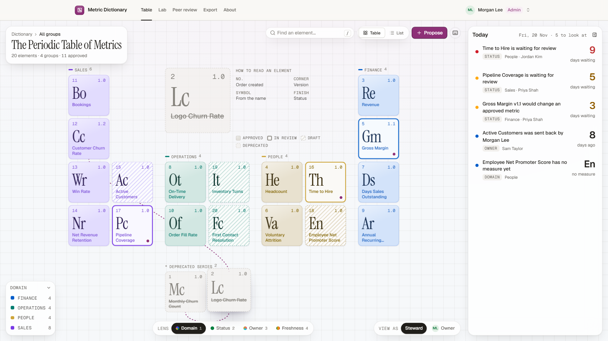

# Metric Dictionary

One searchable place where every business metric has an owner, a plain-English definition, the exact formula in
business words and the name of the measure that implements it. Owners write and maintain their metrics, stewards approve
each version, and the full version history and review trail stay on the metric. Editing an approved metric creates the
next minor version and sends it back for review, while the approved version stays visible. A Fabric App (Rayfin 2.0,
preview) with a Fabric SQL database behind it.



## What it looks like

**The periodic table of metrics.** Every metric is an element tile: its number is the order it was created, its
two-letter symbol comes from its name (unique across the table), its group and colour are its business domain, its
corner shows the version like an atomic mass, and its finish is the status (approved solid, in review outlined, draft
hatched, deprecated faded). The two biggest domains stand tall at the edges, the others sit lower in the middle with
the key in the valley, and deprecated metrics form a detached series with dashed decay lines to their replacements.

- **Lenses** (keys 1–4) re-colour the same table: domain, status, owner, freshness (days since the last change; the
  corner then shows the age). A Today panel ranks the 3–5 things that need attention (oldest reviews, re-reviews,
  drafts sent back, missing measures, the stalest approval); each one focuses the element and switches the lens.
  **View as** (key V) switches between the steward's view and the owner's view, which dims everything you do not own.
  Find (key /) dims all but the matches; arrow keys move between elements; ? shows every shortcut.
- **Tools:** the **Element card** (big term in Instrument Serif, definition, formula, measure, isotopes = versions with
  tracked changes, review trail), the **Lab** (propose or revise a metric with a live element preview and duplicate
  detection by name, synonym and shared word stems), **Peer review** (the stewards' queue with the proposal on a bench
  and tracked changes for re-reviews) and **Export** (a printable A3 table poster, Markdown and CSV).
- **Fallbacks:** a List view (key L) with the same elements as an accessible table; phones get a scrollable grid
  grouped by domain (no horizontal scroll); `?nowebgl` and reduced motion render the table flat (no lift, flip or
  pulse). The table is DOM and SVG, so it needs no WebGL. Screenshots of every screen, light and dark, desktop and
  phone: [docs/redesign/](docs/redesign/).

Demo video (about 2 minutes, AI-generated narration, captions burned in): [demo/out/metric-dictionary.mp4](demo/out/metric-dictionary.mp4) · captions file [demo/out/metric-dictionary.srt](demo/out/metric-dictionary.srt). Re-record with `npx tsx tools/demo/record.ts metric-dictionary` from the repo root.

## 1. Prerequisites

- Microsoft Fabric with the **Fabric Apps** workload enabled for your tenant (preview).
- A Fabric workspace on a capacity (trial or F SKU), and **Contributor** (Edit) permission on it to deploy.
- Node.js 20 or later.
- People who use the app need access to the app item (workspace members get it by default). No semantic model or
  connector is needed: the app stores measure names as text.

## 2. Run locally

```bash
# at the repo root
npm install

# in apps/metric-dictionary
npm run dev          # offline demo on http://localhost:5204: in-memory data, seed, persona switcher
npm run dev:fabric   # rayfin dev: the app against a Fabric backend (needs `npx rayfin login`)
```

Demo mode stores data in your browser only. Switch persona from the identity menu (top right) or open
`/?as=<sub>`; "Reset demo data" re-seeds. Deep links: `/#/?lens=status`, `/#/?view=list&q=churn`, `/#/?el=<metric id>`.

| Persona | Sub | Role |
|---|---|---|
| Morgan Lee | `demo-steward` | Steward (admin) who owns no metrics; the default viewer |
| Priya Shah | `demo-steward-owner` | Steward who also owns metrics, so she cannot approve her own (Pipeline Coverage) |
| Sam Taylor | `demo-owner` | Metric owner (Win Rate, Customer Churn Rate, …) |
| Jordan Kim | `demo-owner-2` | Metric owner (People and Operations metrics) |

Checks: `npx tsc -b`, `npx vitest run`, `npx vite build --mode demo`, `npx playwright test`.

## 3. Deploy

```bash
npx rayfin login
npx rayfin up --workspace-id <workspace-id>
```

`rayfin up` builds the app (`npm run build:fabric`), creates the backend, SQL database and hosting, applies the schema
(including later schema changes) and uploads the site.

## 4. Seed

```bash
# from the repo root
node tools/seed-fabric.mjs --app metric-dictionary --admin-email you@yourorg.com
# or, inside apps/metric-dictionary
npm run seed:fabric -- --admin-email you@yourorg.com
```

Open the deployed app once first so your Person row exists. The script loads the same seed as demo mode (skipped if
already loaded) and makes you a steward. The first persona (Morgan Lee, the steward who owns no metrics) is mapped to
your real admin account, so you start as a steward who can approve every seeded metric in review. It inserts 20 fictional metrics across Finance, Sales, People and Operations:
11 approved, 3 in review (one a re-review of an approved metric, one owned by a steward), 4 drafts (one sent back with
a comment, one with no measure yet) and 2 deprecated metrics forming a replacement chain that ends at Customer Churn
Rate, which has 3 versions; plus 23 version rows and 18 reviews. Persona Person rows are created as the owners and
reviewers. To make someone a steward by hand:

```sql
UPDATE dbo.People SET isAdmin = 1 WHERE email = 'you@yourorg.com';
```

## 5. How it works

| Entity (table) | Purpose | Key fields |
|---|---|---|
| `Metric` (`dbo.Metrics`) | One business metric | name (3–80), domain, definition (≤1000), formula (≤1000), measureName, modelRef, synonyms (comma list ≤300), ownerName, ownerSub, status (`draft`, `in_review`, `approved`, `deprecated`), version, replacedById, approvedVersionId, deprecationNote, submittedAt, createdAt, updatedAt |
| `MetricVersion` (`dbo.MetricVersions`) | Append-only content history | metricId, version, definition, formula, measureName, changedBy, changedBySub, changedAt, changeNote |
| `Review` (`dbo.Reviews`) | Append-only steward decisions | metricId, versionLabel, reviewerSub, reviewerName, decision (`approve`, `changes`), comment (≤500), createdAt |
| `Person`, `AppMarker` | Shared identity and seed marker | as generated |

Rules (all in `src/domain/rules.ts` and `src/domain/metrics.ts`, unit-tested):

1. Names are unique ignoring case and surrounding or repeated spaces. The editor warns as you type and offers "Open the
   existing one"; the domain function refuses duplicates.
2. New metrics are drafts at v1.0. Submit for review moves them to `in_review`.
3. A steward (Person.isAdmin) who is not the owner approves (`approved`, approvedVersionId = the reviewed version row) or
   requests changes (`draft`, the comment shows on top of the metric).
4. Saving a change to the definition, formula or measure appends a `MetricVersion`. On an approved metric it also bumps
   the minor version (1.0 to 1.1), sets `in_review`, and keeps approvedVersionId, so the page shows
   "v1.0 is the approved version" with a diff. Name, domain, synonyms and model edits are not versioned.
5. Deprecation needs a note and may name a replacement (no loops). Deprecated metrics have a struck-through title, a
   link to the end of the replacement chain, and can no longer be edited.
6. Search (`src/domain/search.ts`): any name hit ranks above any synonym hit, then measure-name hits, then definition or
   formula hits; within a field exact > prefix > word start > contains.
7. Stale edits: saving re-reads the metric and, if `updatedAt` moved since the form loaded, asks before saving. If you
   confirm, your save wins.

The editor's "Changes since approved" panel and the history's "Show changes" use a word-level LCS diff
(`src/domain/diff.ts`): added words are underlined with a "+", removed words are struck through with a "−", so colour is
not the only signal.

### Security model

| Entity | Read | Create | Update | Delete |
|---|---|---|---|---|
| Metric | everyone signed in | `claims.sub = ownerSub` **and** `status = 'draft'` | `claims.sub = ownerSub` **or** `status = 'in_review'`; `ownerSub`, `createdAt` excluded | nobody |
| MetricVersion | everyone signed in | `claims.sub = changedBySub` | nobody | nobody |
| Review | everyone signed in | `claims.sub = reviewerSub` | nobody | nobody |
| Person | as generated (own row only, `isAdmin` excluded) | | | |

Enforced in the domain (both modes): only owners edit, submit and deprecate; only stewards review, never their own
metric; status transitions; unique names; stale-edit check.

Checked again on read, on the metric page (`approvalCheck` in `src/domain/rules.ts`, unit-tested):

- Version rows count only when written by the metric's owner; reviews only when written by a steward who is not the
  owner (Person.isAdmin cannot be set by a client). Ignored rows are counted under the history.
- An `approved` status is shown as verified ("Approved by … on …") only when all of these hold: a trusted steward
  review approved the current version label; `approvedVersionId` points at a trusted version row with that label; and
  the stored definition, formula and measure name equal both that approved row and the newest owner-written row.
- Otherwise the page shows **"Approval not on record"** (no steward approval for the label, or the approved version row
  is missing or has another label) or **"Changed since approval"** (the definition, formula or measure was changed
  without a new version going through review, for example by patching the row through the API), naming the fields.
- Not detected: a direct API change to name, domain, synonyms or semantic model (these are never versioned), and
  changes to a metric that is not `approved`. Table tiles and the export show the stored status; the check runs on the
  metric page.

## 6. VERIFY outcomes and known limits

- Number types, enums, polling, charts, claims, roles: see `shared/NOTES.md` (Rayfin 2.0.0). This app uses `@set` for
  status and decision, plain uuid id columns, and polls the Peer review queue (a live screen for stewards) every 5 s.
- The policy DSL supports `eq`, `neq`, `and`, `or` on claims and fields (checked in `rayfin-core` 2.0 typings).
  **Deployed to Fabric on 20 Nov 2026:** the schema applied with every policy accepted, including the Metric create
  policy (`ownerSub` and `status = 'draft'`), the update policy (`owner or in_review`, with `ownerSub` and `createdAt`
  excluded) and the create-only policies on MetricVersion and Review.
- **Known limit: steward rights are not a database rule.** There is no admin claim, and a steward must be able to update
  a metric they do not own to approve it. So while a metric is `in_review`, any signed-in user could change it through
  the GraphQL API, and an owner can update their own metric in any status (including setting `approved`, or editing an
  approved metric's definition without a new version). The element card detects these cases as described under
  "Checked again on read" ("Approval not on record" / "Changed since approval"); it cannot prevent them, and table
  tiles and the export still show the stored status. Full enforcement needs dynamic auth claims (`udf.authClaims`) or a
  server function; see Later.
- A non-owner can insert MetricVersion or Review rows for any metric through the API; they are ignored on read and the
  page notes how many rows were hidden.
- The Fabric build embeds the Rayfin API URL (which contains the tenant and workspace ids) and the publishable key in
  the JavaScript bundle. Neither is a secret: the key only identifies the app, and every data call needs a Fabric
  sign-in and passes the row policies above. They are written to a local env file by `rayfin up` (`*.local`, ignored by git) and are not
  committed.
- `ownerName` is copied when a metric is created and does not follow later display-name changes.
- Deprecation cannot be undone in the app (a deployer can reset `status` with SQL).

## 7. Later

- Check that the named measure exists in a bound semantic model through the connector.
- Link a metric to its tests in Measure Unit Tests.
- Database-level steward enforcement with dynamic auth claims or a Rayfin function for approvals.
- Ownership transfer, and undo for deprecation.

## 8. Gallery

- **Title:** 12 Days of Fabric Apps: Day [#] – [Theme]: Metric Dictionary
- **Blurb:** The periodic table of metrics. Every business metric is an element: its symbol, its domain as the group
  colour, its status as the tile finish, its versions as isotopes with tracked changes. Lenses re-colour the table by
  status, owner and freshness; a Today panel takes stewards straight to the oldest review. Propose metrics in the Lab
  with live duplicate detection, approve them in Peer review, and export the approved table as a printable poster,
  Markdown or CSV.
- **Tags:** Partner | 12 Days of Fabric Apps, Fabric Apps, Data governance, Semantic models, Power BI

Built by Datachain Consulting for AI @Work.
